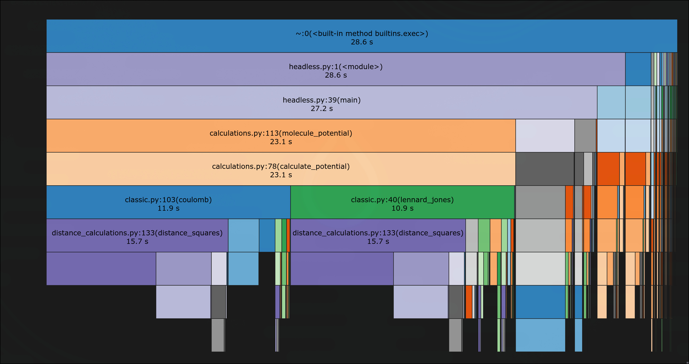
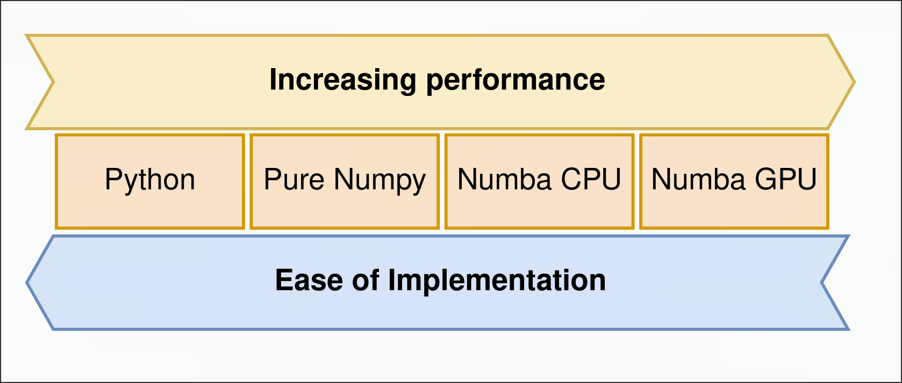

# MolecularSim

This repository contains the software and resources for *Laboratory Course Computational Physics, WS 24/25*.

## Introduction

MolecularSim is a Metropolis Monte-Carlo engine for rigid molecules (e.g.
water) in a periodic box. Molecules are randomly translated and rotated and
each move is accepted with probability $\min(1, e^{-\beta \Delta E})$, so the
sampled configurations follow the Boltzmann distribution and ensemble
properties (energies, radial distribution functions, ...) can be measured in
statistical equilibrium. Interactions are modelled with Lennard-Jones and
Coulomb pair potentials.

The naive total energy scales as $O(N^2)$ in the number of atoms. Since a
Monte-Carlo step only moves a single molecule, we compute only the energy
difference $\Delta E = E'_\mathrm{mol} - E_\mathrm{mol}$, which reduces the
cost per step to $O(N)$.

### What has been done

- **Simulation core**: Z-matrix/Cartesian input parsers, a structure-of-arrays
  system layout, minimum-image distance calculations, molecule mutation
  (translation/rotation) and the Metropolis loop.
- **Potentials**: Lennard-Jones and Coulomb with several interchangeable
  backends — pure Python, vectorized NumPy, Numba (CPU) and Numba (GPU/CUDA),
  plus an Ewald summation variant.
- **Profiling**: the vectorized NumPy version was profiled; the flame graph
  below shows that most time is spent in `distance_squares` inside the Coulomb
  and Lennard-Jones terms, which motivated the Numba backends.

  

- **Benchmarks**: the backends were benchmarked against each other, trading
  ease of implementation for performance:

  

- **Tooling**: an interactive Streamlit app, a headless runner for
  pre-equilibration, debug/inspection tools and a benchmark script.

The accompanying presentation is in [resources/slides.md](resources/slides.md)
([rendered HTML](resources/slides.html)).

## Project structure

The project is structured as two different installable python packages:

- [**`molecsim`** ](molecsim/) as the core simulation packages.
- [**`molecsim-tools`**](molecsim_tools/) for visualization and development tools.

## Resources

Resources such as the [Lab Guide](resources/MC_Mol.pdf) can be found in the [resources](resources) directory.

## Contributors

[Christof Stein](mailto:christof.stein@student.uibk.ac.at).

[Niklas Peter](mailto:niklas.peter@student.uibk.ac.at)

[Dmytro Iazykov](mailto:dmytro.iazykov@student.uibk.ac.at)

## Development setup

The repository contains two installable subprojects.

### Install core library (simulation engine)

```bash
pip install -e molecsim
```

For development and testing:

```bash
pip install -e molecsim[dev]
```

This installs the simulation engine without any UI or Streamlit dependencies.

### Install tools and apps (optional)

The tools package provides Streamlit and other analysis utilities and depends on `molecsim`:

```bash
pip install -e molecsim-tools
```

## Running calculations

Apps are intentionally not part of the core library. They live in the `molecsim-tools` package and are optionally exposed via small launcher scripts under `apps/`.

## Streamlit Web App

The main interactive interface is a Streamlit web application.

After installing `molecsim-tools`, you can either:

### Run via installed command (recommended)

```bash
molecsim-streamlit
```

### Or run the thin launcher script

```bash
python apps/streamlit_mc.py
```

This launches the UI in your browser and provides live interaction with the Monte-Carlo simulation.

## Headless mode

Headless execution is used to pre-equilibrate systems or generate data for further analysis.

Example:

```bash
python apps/headless.py \
    -f tests/data/water_zmatrix.com \
    -n 2 \
    -t 10 \
    -b 10,10,10 \
    -s 10000 \
    -o out/state_final.pickle \
    --seed 10
```

This runs a Monte-Carlo simulation without UI and writes the final system state to disk.

## Debug / inspection tools

Distance calculations and minimum-image conventions can be inspected using the debug utilities:

```bash
python apps/show_traces.py
```

These tools are intended for development and validation, not for production runs.

## Showcase app

A small showcase app demonstrates how to interact with the simulation engine programmatically:

```bash
python apps/calculate_between.py \
    -f tests/data/water_zmatrix.com \
    -n 5 \
    -t 10 \
    -b 10,10,10 \
    --seed 1
```

## Notes

- `molecsim` never depends on Streamlit or UI code.
- `molecsim-tools` may change rapidly and is intended for development, analysis, and visualization.
- The `apps/` directory only contains thin entry scripts and is not packaged.

## License

This project is licensed under the GNU General Public License v3.0 — see
[LICENSE](LICENSE) for details.
