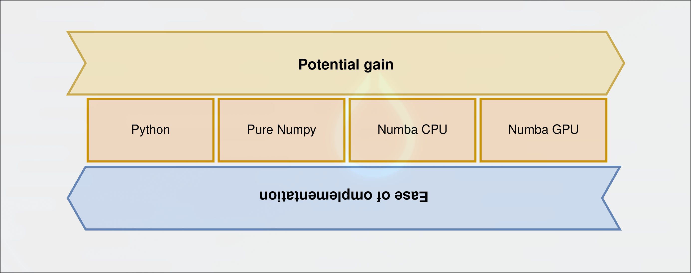

<h1 style="text-align:center;">Molecular Monte Carlo</h1>

<div style="display:flex; justify-content:center;">
  <div style="width:400px; height:400px;">
    <iframe src="images/plot.html"
            style="width:100%; height:100%; border:none;"></iframe>
  </div>
</div>

<h3 style="text-align:center;">Profiling and accelerating Python code</h3>


---

## Introduction - Molecular Monte Carlo


**Ensemble properties** in **statistical equilibrium**


---

## Aims and Goals - Computational  Demand
$$
E_\mathrm{C} = \sum_{i\neq j}^N \frac{1}{4 \pi \epsilon_0} \frac{q_i q_j}{\vec{r_i}-\vec{r_j}}
\hspace{20px}
E_\mathrm{LJ} = \sum_{i\neq j}^N c_{ij}\left[\frac{A}{(\vec{r_i}-\vec{r_j})^{12}} - \frac{B}{(\vec{r_i}-\vec{r_j})^{6}}\right]
$$
$N$ atoms demand $O(N^2)$! 
 $$E = E_\mathrm{mol} + E_\mathrm{rest}  \hspace{20px} \Rightarrow \hspace{20px} \Delta E = E'_\mathrm{mol} - E_\mathrm{mol}$$
Molecules of size $n$ only $O(n * N) \rightarrow O(N)$!

---

## Implementation - Numpy Vectorized

```python
def distance_squares(r_i, r_j):
	dv = r_i[:, None, :] - r_j[None, :, :]
	return np.einsum("mni->mn", dv * dv)

def coulomb(r_i, r_j, q_i, q_j):
    r2 = distance_squares(r_i, r_j)
    dists = np.sqrt(r2)

    mask = extra_interaction_mask(r_i, r_j)
    dists[~mask] = np.inf

    q_i_q_j = q_j[None, :] * q_i[:, None]
    E = q_i_q_j / dists
    return E
``` 

---
## Benchmarks - Numpy Vectorized

<div style="display:flex; justify-content:center;">
  <div style="width:100%; height:400px;">
    <iframe src="images/bench_loop_step_multi.html"
            style="width:100%; height:100%; border:none;"></iframe>
  </div>
</div>

---
## Implementation - Profiling

<div style="display:flex; justify-content:center;">
  <div style="width:100%; height:500px;">
    <iframe src="images/profile_report.html"
            style="width:100%; height:100%; border:none;"></iframe>
  </div>
</div>


---
## Implementation - Numba (CPU)

> Numba is an [...] **optimizing compiler** for Python which can compile [...] **numerically-focused Python** [...] for automatic **parallelization** of loops, generation of **GPU-accelerated** code.

Applied using **decorators** to existing code:

```python
@njit(cache=True, fastmath=True, nogil=True, parallel=True)
def inner_product(x):
    s = 0.0
    for i in range(x.shape[0]):
        v = x[i]
        s += v * v
    return s
```

---
## Implementation - Numba (CPU) 

```python
@njit(fastmath=True, parallel=True)
def _coulomb_extra_dense(
    r2: np.ndarray,
    q_i: np.ndarray,
    q_j: np.ndarray,
) -> float:
    acc = 0.0
    for i in prange(r2.shape[0]):
        qi = q_i[i]
        local = 0.0
        for j in range(r2.shape[1]):
            rij = np.sqrt(r2[i, j])
            local += (qi * q_j[j]) / rij
        acc += local
    return coeff * acc
```

---
## Benchmarking - Numba (CPU)

<div style="display:flex; justify-content:center;">
  <div style="width:100%; height:400px;">
    <iframe src="images/bench_loop_step_multi.html"
            style="width:100%; height:100%; border:none;"></iframe>
  </div>
</div>

---
## Implementation - Numba (GPU)

```python 
@cuda.jit
def coulomb_kernel(data_pos, data_q, mol_pos, mol_q):
	"""Each thread handles atom i from data and calculates E_i0 + ... + Eij"""
	i = cuda.grid(1)
    M = data_pos.shape[0]
    N = mol_pos.shape[0]

    smem = cuda.shared.array(256, dtype=np.float64)  # assumes blockDim<=256
    tid = cuda.threadIdx.x
    ...
```

```python 
# call kernel
coulomb_extra_kernel[blocks, threads](data_pos, data_q, mol_pos, mol_q)
```
---
## Benchmarking - Numba (GPU)

<div style="display:flex; justify-content:center;">
  <div style="width:100%; height:400px;">
    <iframe src="images/bench_loop_step_multi.html"
            style="width:100%; height:100%; border:none;"></iframe>
  </div>
</div>

--- 
## Summary




